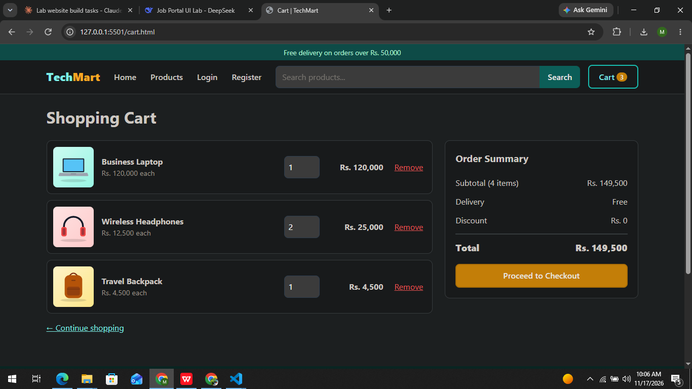
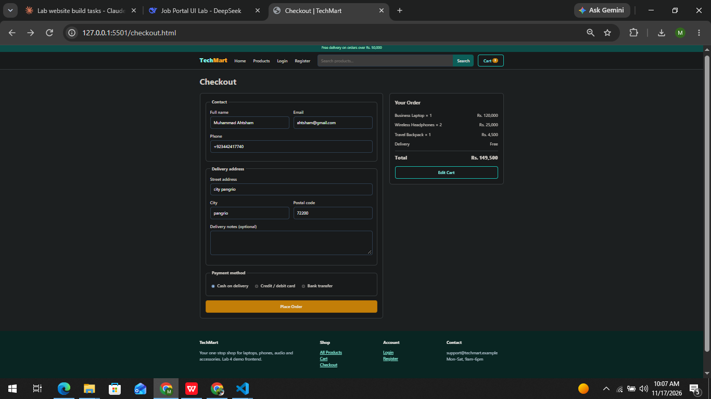

Static, responsive e-commerce frontend built with HTML5 and CSS3 only (no Bootstrap, no JavaScript framework).

## Pages
Home, Products, Product Details, Cart, Checkout, Login, Register.

## Run it
1. Copy the `store` folder into `C:\xampp\htdocs\`
2. Start Apache in XAMPP
3. Open http://localhost/store/

## Lab requirements covered
| Requirement | Where |
|---|---|
| CSS Grid for product listings | `.product-grid` (1 / 2 / 4 columns) |
| Flexbox for navbar and card internals | `.nav`, `.product-card`, `.cart-item`, `.chips`, `.features` |
| Mobile, tablet, desktop layouts | Mobile-first: base = mobile, `min-width: 600px` tablet, `min-width: 900px` desktop |
| Responsive images | `img { max-width: 100%; height: auto }`, `aspect-ratio`, width/height attributes |
| Accessible buttons | Real `<button>`/`<a>`, 44px minimum target, visible focus ring, aria-labels |
| Basic: category filter UI | Chips + sort select on `products.html` |
| Basic: responsive checkout form | `checkout.html` (2 columns on tablet+, 1 on mobile) |
| Basic: product details with gallery and purchase panel | `product.html` (CSS-only gallery) |

## Test with DevTools device emulation
Press F12, then Ctrl+Shift+M. Check at 375px (mobile), 768px (tablet), 1280px (desktop).

## Screenshots to take for submission
1. Products page on desktop (4-column grid)
2. Products page on tablet (2 columns) and mobile (1 column)
3. Product details page (gallery + purchase panel)
4. Cart or Checkout page
